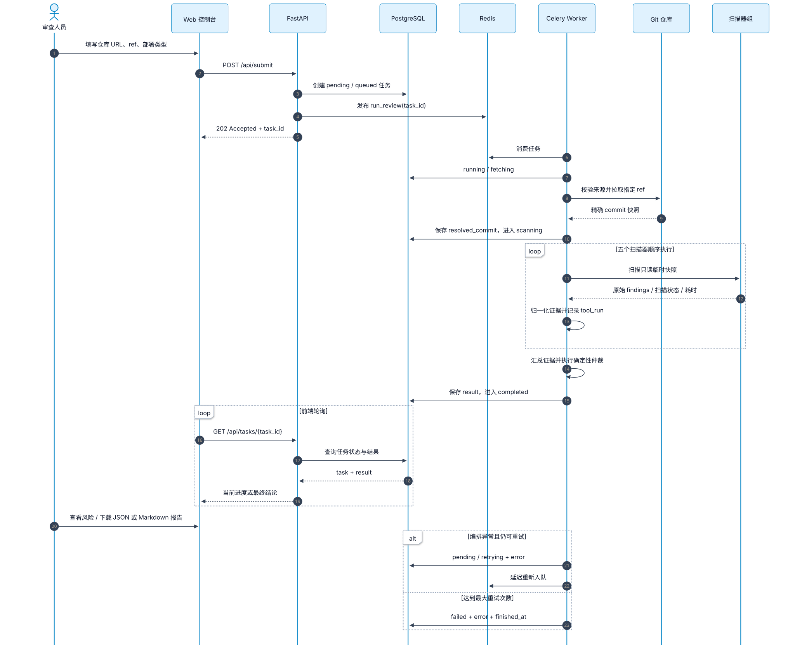

# 系统架构

MCP Audit 由 Web 控制台、FastAPI、PostgreSQL、Redis、Celery Worker 和数据库迁移任务组成。
API 负责接收与查询任务，Worker 负责获取不可变代码快照、运行安全检查和生成确定性结论。

## 组件架构

主要边界如下：

- **访问层**：Web 控制台只通过同源 FastAPI 接口提交任务、轮询进度和下载报告。
- **任务与数据层**：PostgreSQL 保存任务生命周期和最终结果；Redis 承担 Celery Broker 与结果后端；Alembic 在服务启动前维护数据库结构。
- **隔离审查层**：Worker 拉取精确 commit，对只读临时快照运行五类检查，并在结束后清理快照。
- **外部只读来源**：Git 托管平台提供源码，Semgrep Registry 提供公开安全规则，OSV 提供依赖漏洞情报。

API 不会执行被审查仓库中的代码。仓库快照在扫描前接受来源、DNS、大小、文件数量和符号链接边界检查。

## 审查任务时序

任务提交后立即返回 `task_id`。后台 Worker 依次经历 `fetching → scanning → arbitrating → completed`；
编排异常会进入有限重试，超过最大次数后保存为 `failed`。前端在整个过程中通过任务查询接口轮询状态。

## 扫描与仲裁流水线

五个扫描器产生的不同格式结果统一进入 `evidence.normalize_finding`。系统同时记录每个扫描器的成功或失败、
耗时和发现数量。任何必需扫描器失败都代表覆盖不足，因此不能得到 `PASS`。

最终结果采用版本化 `ReviewResult`：

- `findings`：归一化后的安全证据；
- `tool_runs`：每个扫描器的运行状态与覆盖情况；
- `summary`：按风险和类型汇总的统计；
- `decision`：`PASS`、`MANUAL_REVIEW` 或 `REJECT` 及其原因。

新增扫描器时，应返回可由 `evidence.normalize_finding` 归一化的字典，并在 `tasks._run_checks` 中注册。

## 图表维护

图表的 Mermaid 源文件和生成命令位于 [`docs/diagrams`](diagrams/README.md)。修改架构时先更新 `.mmd`
源文件，再重新生成并提交对应 SVG，确保文档和图片保持同步。

